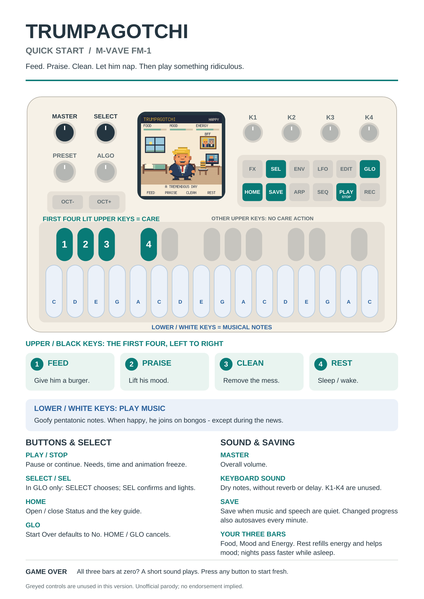

# Trumpagotchi for M-VAVE FM-1

A tiny, demanding Trump lives in your synthesizer. Feed him burgers, shower him with praise, clean up his mess and put him to bed. When he’s happy, he joins your pentatonic keyboard playing on bongos. The news is bad for his mood and very good for his appetite.

**Unofficial parody.** Recorded audio may be edited and recombined for fictional game dialogue. No affiliation or endorsement is implied.

## Download and install

You need an **M-VAVE FM-1**, a USB data cable and a computer with [Python 3](https://www.python.org/downloads/). You do not need to compile the firmware.

1. Open this repository’s **Releases** and download **trumpagotchi.fwsc** and **trumpagotchi-source.zip** from the same release.
2. Extract the source ZIP. Open the folder containing this README, `requirements-install.txt` and `tools`. Put `trumpagotchi.fwsc` in that folder. Do not unzip the `.fwsc` file.
3. Open a terminal in that folder. On macOS, type `cd `, drag the folder from Finder into Terminal and press Return. On Windows, open the folder in Explorer, click its address bar, type `cmd` and press Enter.
4. Set up the installer, one command at a time:

**macOS / Linux**

```sh
python3 -m venv .venv
. .venv/bin/activate
python -m pip install -r requirements-install.txt
```

**Windows Command Prompt**

```bat
py -m venv .venv
.venv\Scripts\activate
python -m pip install -r requirements-install.txt
```

5. Connect the FM-1. Close music software and browser MIDI connections that may be using it. Check the connection:

```sh
python tools/fm1_install.py --info
```

6. Install:

```sh
python tools/fm1_install.py trumpagotchi.fwsc
```

Read the prompt, check the intended device and type `y`. Keep USB connected until the write and restart finish. A successful install reports **FM-1_710**.

This replaces the device’s current firmware. The supplied package has been installed and its restart checked on our FM-1; not every starting firmware or computer setup has been tested. If the installer rejects the package or device, stop and keep the error message rather than forcing it.

## Quick start

[Download the illustrated guide (PDF)](docs/trumpagotchi-quick-start.pdf) · [Image copy (PNG)](docs/trumpagotchi-quick-start.png)



| Control | What it does |
| --- | --- |
| Lower white keys | Play the corny pentatonic instrument. Happy Trump joins on bongos. |
| First four upper black keys, left to right | **Feed · Praise · Clean · Rest**. These stay lit; the remaining upper keys have no care action. |
| HOME | Open or close Status and the controls guide. |
| GLO | Open the key guide and **Start Over**. |
| SELECT knob / SEL | Choose No or Yes and confirm within GLO. SEL lights only there. |
| PLAY / STOP | Pause or continue the pet, clock and audio. |
| SAVE | Save progress once the current audio is quiet. Look for **PET SAVED**. |
| MASTER | Overall volume. |

FX and the four former effects knobs are unused. Keyboard notes have no reverb or delay.

Feed also refills his burger stack. Praise lifts his mood; Clean removes wrappers and cartoon poo. Rest puts him to bed or wakes a nap. A day lasts five minutes; sleeping at night speeds through to dawn and restores full energy. Progress autosaves about once a minute when quiet. Time spent powered off does not drain his needs.

When **Food, Mood and Energy** all reach zero, **Game Over** appears with a quiet “wamp wamp wah.” Press a fresh button or key to restart with full bars. GLO also lets you start over deliberately, defaulting to No.

## Troubleshooting

| Problem | Try this |
| --- | --- |
| Python not found | Install Python 3 and reopen the terminal; on Windows start with `py`. |
| Files not found | Make sure the terminal is in the folder with this README and the firmware file. |
| No FM-1 found | Use a USB data cable and close applications using MIDI. |
| More than one possible MIDI port | Add `--port "part of the FM-1 port name"` using a name reported by the installer. |
| Interrupted update / still in update mode | Run the same install command again to finish it. Keep USB connected. |
| Save failed | Let the audio stop and press SAVE again. Keep the error details if it continues. |

## Source and credits

The ready-to-install package corresponds to the included source and twelve voice clips. Developers can follow [BUILDING.md](BUILDING.md). [Voice-source credits](docs/VOICE-SOURCES.md) link to the government recordings used during editing.

Code and original artwork: **GPL-3.0-only**. Recording rights are separate from the code licence. Inherited platform, SDK, font and sound-data notices are preserved in [LICENSING.md](LICENSING.md) and `LICENSES/`.
